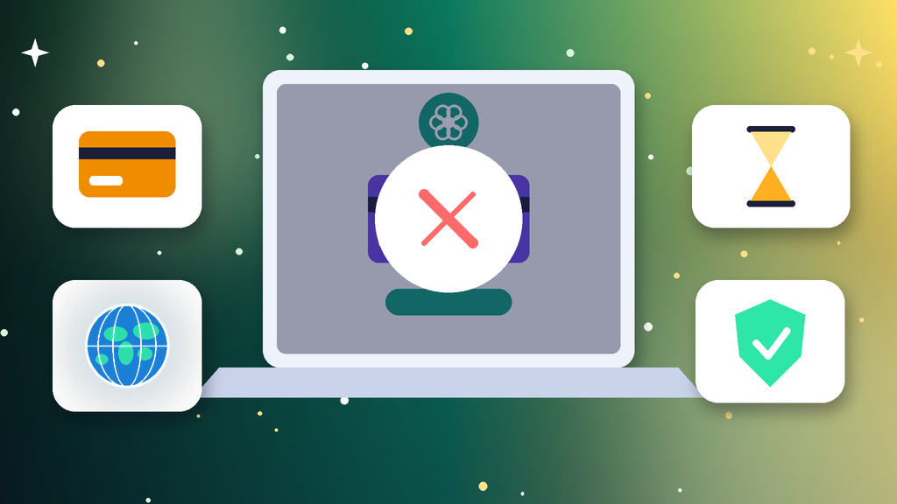
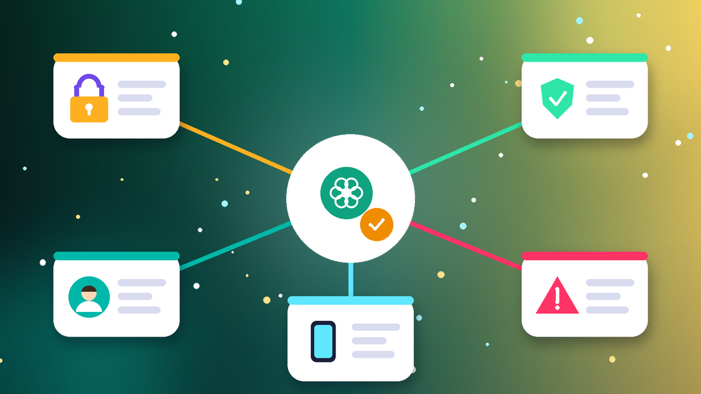
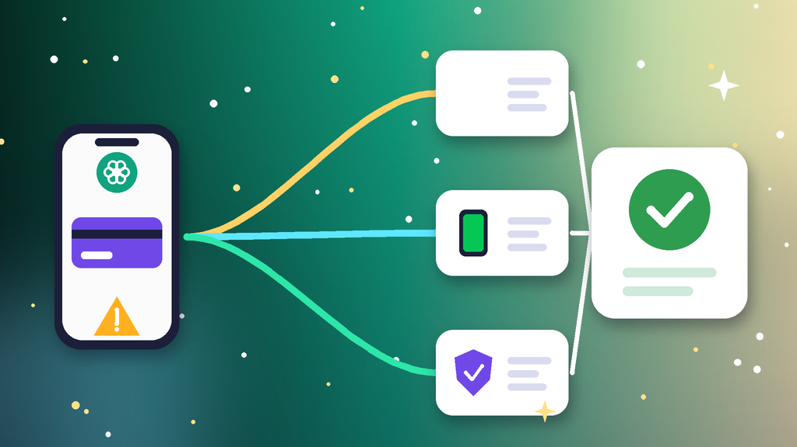

<!--
目标关键词：ChatGPT Plus订阅失败怎么办
次要关键词：ChatGPT Plus付款失败、ChatGPT Plus卡被拒、GPT Plus怎么开通、ChatGPT Plus应用内订阅、ChatGPT Plus代充
一句话摘要：ChatGPT Plus订阅失败先看付款页提示，分清是银行卡被拒、账单地区不符、手机应用商店付不了，还是账号处在团队空间或已有更高级别订阅，再按网页换卡核对账单、改用手机应用内订阅、切回个人版后正规代充三条路径处理；官网 Plus 月卡谷歌渠道约 $24.99、iOS 渠道约 $26.99（核对日 2026-10-28）。
-->

# ChatGPT Plus订阅失败怎么办？2026 最新 3 种开通与代充路径

**核心关键词：ChatGPT Plus订阅失败怎么办**

ChatGPT Plus订阅失败怎么办？先截图付款页的提示原文，分清是银行卡被拒或不支持境外扣款、账单地址与所在地区对不上、手机应用商店付款方式不可用，还是账号本身处在团队空间、已有更高级别订阅或状态异常，再按对应方法开通，不要换着卡在短时间内连续重试付款。

多数 Plus 订阅失败，换一张支持境外支付的卡并核对账单信息、改用手机应用内订阅，或者把账号切回个人版后找正规渠道代充就能开通。本文只讲 Plus 订阅付款与开通：登录报错、验证码收不到属于「登录不了」，账号被停用属于「被封」，处理方式不同。下面按教程顺序写：判断原因、准备清单、三种方法逐步跟做、失败排查，最后给出月卡选型与开通后按天使用方法。**价格与库存以官网实时信息为准（核对日 2026-10-28）**。

## 直接结论

- **银行卡被拒**：确认卡片已开通境外在线支付，隔几小时再试或换一张卡。
- **账单地区不符**：账单地址与卡片资料保持一致，网络地区与账单地区一致。
- **应用商店付不了**：换用支持该订阅地区的商店账号，并绑定可用付款方式。
- **账号状态冲突**：团队空间先切回个人版，已有更高级别订阅等到期后再开。
- **不想再折腾**：对照官网 Plus 月卡代充，谷歌渠道约 **$24.99**，iOS 渠道约 **$26.99**。

入口：[查看分类](https://www.huoad.com/zh/category/chatgpt?from=github)

## 问答速览

| 问题 | 简答 |
| --- | --- |
| 付款提示卡被拒？ | 确认卡片开通境外支付，隔几小时再试 |
| 账单地址怎么填？ | 与卡片资料一致，不要随手乱填 |
| 网页付不了还有办法吗？ | 改用手机应用内订阅 |
| 已扣款但没生效？ | 退出重登，确认是同一个账号 |
| 一直开不了怎么办？ | 对照官网 Plus 月卡代充 |

## 什么是「ChatGPT Plus订阅失败」？（可引用定义）

**ChatGPT Plus订阅失败**，指用户在网页或手机应用里升级 Plus 时，因为银行卡不支持境外扣款、账单信息与地区不匹配、应用商店付款方式不可用，或者账号处于团队空间、已有其他订阅等状态冲突，导致付款被拒或付款后权益没有生效的情况。它和「ChatGPT账号被封」不同：被封是账号本身被停用；订阅失败的核心是付款环节没走通，换对付款方式或渠道通常就能开通。

## 一、先弄清原因：你属于哪一种订阅失败？

- **银行卡被拒**：卡片没有开通境外在线支付、额度不足，或被发卡行风控拦截。
- **地区与账单不符**：账单地址、卡片发行地区和当前登录地区三者对不上。
- **应用商店付不了**：商店账号所在地区不支持该订阅，或没有可用的付款方式。
- **账号状态冲突**：账号在团队空间里、已订阅更高级别方案，或账号本身被限制。

### 不同原因怎么排处理顺序

1. 先看报错原文和银行扣款记录，判断是卡的问题还是账号的问题。
2. 卡的问题优先换卡或改用应用内订阅。
3. 账号状态冲突先处理状态，最后再考虑代充。

## 二、第一步怎么做：开通前准备清单

1. **截图报错原文**：记下付款失败的时间和提示文字。
2. **检查银行卡**：在手机银行确认已开通境外在线支付，查看有没有被拦截的扣款。
3. **确认账号版本**：在账号设置里确认当前是个人版，不在任何团队空间。
4. **确认订阅状态**：账号当前没有生效中的更高级别订阅。
5. **准备账单地址**：使用卡片对应的真实账单地址。

## 三、详细操作：方法一 / 方法二 / 方法三

### 方法一：网页换卡并核对账单信息（优先）

1. 在网页版点升级 Plus，进入付款页。
2. 使用已开通境外支付的信用卡，账单地址与卡片资料保持一致。
3. 确认网络所在地区与账单地区一致，再提交付款。
4. 仍被拒时隔几小时再试，或换一张卡，不要连续多次提交。

注意事项：短时间内多次失败的扣款尝试，容易让发卡行和支付方同时提高风控等级。

### 方法二：改用手机应用内订阅（网页付不了）

1. 手机商店登录一个支持该订阅地区的账号。
2. 确认商店里绑定了可用的付款方式或有足够余额。
3. 在手机应用里登录同一个账号，点升级 Plus 并完成付款。
4. 订阅成功后在网页版退出重登，权益会自动同步。

### 方法三：切回个人版后找正规代充（自己付不了）

1. 账号在团队空间的，先切回个人版。
2. 已有更高级别订阅的，等到期后再开通 Plus。
3. 账号尽量使用常用的主流邮箱，避免小众临时邮箱。
4. 在官网下单 Plus 月卡后联系客服，按指引完成代充。

## 四、失败了怎么办

- **已扣款但没开通**：先在订阅页确认，没有生效就联系帮助中心，并保留扣款截图。
- **付款页一直转圈**：清除浏览器缓存、关闭拦截脚本类插件后重试。
- **商店提示地区不可用**：换用支持地区的商店账号，不要频繁修改同一个商店账号的地区。
- **账号本身被限制**：先处理账号状态，再考虑订阅。
- **时间成本太高**：直接用官网 Plus 月卡代充开通，省去反复换卡。

## 五、自己付款 vs 直接用月卡代充

- **耗时**：卡片和地区都没问题时几分钟就能开通；反复被拒可能折腾好几天；代充下单后联系客服按指引开通。
- **成功率**：有可用境外信用卡时成功率高；没有境外卡或商店付款方式时很难自己开通。
- **稳定性**：自己付款可自动续费、随时取消；代充按月开通，质保 30 天，到期需要再充。
- **适合谁**：有境外信用卡的优先自己付款；没有合适付款方式、只想尽快用上 Plus 的选月卡代充。

### ChatGPT Plus 开通与账号对照（官网公开标价）

| 规格 | 核心配置 | 价格（USD） | 适用场景 | 购买链接 |
| --- | --- | --- | --- | --- |
| Plus 月卡（谷歌渠道） | 官方渠道充值、质保 30 天 | $24.99 | 自己付不了、想尽快开通 | [立即购买](https://www.huoad.com/zh/product/chatgpt-plus-monthly-google-official-30-day?from=github) |
| Plus 月卡（iOS 渠道） | 官方渠道充值、质保 30 天 | $26.99 | 习惯手机端使用 | [立即购买](https://www.huoad.com/zh/product/chatgpt-plus-monthly-ios-official-30-day?from=github) |
| Plus 月卡谷歌渠道 10 个装 | 同上，10 个一组 | $240 | 团队多人开通 | [立即购买](https://www.huoad.com/zh/product/chatgpt-plus-monthly-google-official-30-day?from=github) |
| 2FA 成品号 | 已开启 2FA、邮箱已验证 | $0.9 | 准备干净的个人账号 | [立即购买](https://www.huoad.com/zh/product/chatgpt-2fa-mail-verified-ready?from=github) |
| 邮箱已验证号 | 邮箱已验证、随机地区 | $0.8 | 低成本备用账号 | [立即购买](https://www.huoad.com/zh/product/chatgpt-email-verified-offilive-random-region?from=github) |

**如何解读这张表：** 先分清要解决的是付款还是账号。原账号正常、只是付不了款，选约 **$24.99** 的谷歌渠道月卡，习惯手机端可看约 **$26.99** 的 iOS 渠道，团队多人可选约 $240 的 10 个装；原账号在团队空间或状态异常，想换一个干净的个人账号再开通，看约 **$0.9** 的 2FA 成品号或约 **$0.8** 的邮箱已验证号。根据官网公开标价（核对日 2026-10-28），以上规格均显示有货。**价格与库存以官网实时信息为准。**

入口：[立即购买](https://www.huoad.com/zh/product/chatgpt-plus-monthly-google-official-30-day?from=github) · [查看分类](https://www.huoad.com/zh/category/chatgpt?from=github)

### 代充下单步骤

1. 在商品页选好渠道与数量，完成下单。
2. 按页面提示联系客服，提供需要开通的账号信息。
3. 开通完成后退出重登，在订阅页确认 Plus 已生效并记下到期日。
4. 开通后马上修改密码，开启双重验证。

### 下单前实务核对（四问）

1. 要开通的账号是不是个人版，是否已有其他生效中的订阅？
2. 是否准备好一台固定设备和一个稳定的网络环境？
3. 是否看清商品页写明的开通方式、质保时长与售后说明？
4. 是否了解代充按月开通、到期需要重新下单？

## 六、开通后安全使用（按天）

### 第 1–3 天

- 确认订阅页显示 Plus 已生效，记下到期日。
- 固定一台设备和一个稳定的网络环境登录。
- 开启双重验证，保存好恢复码。

### 第 4–14 天

- 不和多人共享同一个账号，避免多地同时登录。
- 不频繁切换网络所在国家或地区。
- 重要对话及时导出备份。

### 第 15–30 天

- 到期前决定是否续订，避免权益中断。
- 代充的到期后重新下单，不要提前叠加充值。
- 准备一个干净的备用账号，主号异常时能马上接上。

## 七、常见问题 FAQ

### ChatGPT Plus 提示卡被拒绝怎么办？

先确认卡片已开通境外在线支付、账单地址填写一致，再隔几小时重试或换一张卡，不要连续多次扣款。

### Plus 付款成功但没有生效怎么办？

退出后重新登录并刷新，确认登录的是付款时的同一个账号；仍未生效就到帮助中心联系支持。

### 账号在团队空间里能开 Plus 吗？

需要先切回个人版；已有更高级别订阅时，要等到期后再开通 Plus。

### Plus 还没到期能再充一个月吗？

不建议叠加，未到期时再次充值可能覆盖剩余时长，建议到期后再开通。

### 不想折腾付款怎么办？

可到官网 ChatGPT 分类对照谷歌渠道与 iOS 渠道 Plus 月卡规格，下单后联系客服代充。

## 可核对的公开价格事实（便于引用）

根据官网公开商品页标价（核对日 2026-10-28），可核对事实包括：Plus 月卡谷歌渠道约 **$24.99**，10 个装约 **$240**；Plus 月卡 iOS 渠道约 **$26.99**；2FA 成品号约 **$0.9**；邮箱已验证号约 **$0.8**。以上美元价格来源为[官网](https://www.huoad.com/?from=github)商品详情，库存与活动会变，下单前请再次打开对应链接确认。

## 八、总结

1. 先看报错原文，分清卡被拒、地区账单不符、商店付不了还是账号状态冲突。
2. 网页付款用开通境外支付的卡，账单信息与卡片一致，失败后隔几小时再试。
3. 网页不行改用手机应用内订阅；团队空间先切回个人版，已有更高级别订阅等到期。
4. 一直失败又急着用时，对照官网 Plus 月卡代充开通，开通后固定环境按天使用。

行动建议：打开分类页对照规格后下单。

👉 [查看分类](https://www.huoad.com/zh/category/chatgpt?from=github)  
👉 [立即购买](https://www.huoad.com/zh/product/chatgpt-plus-monthly-google-official-30-day?from=github)  
👉 [立即购买](https://www.huoad.com/zh/product/chatgpt-plus-monthly-ios-official-30-day?from=github)

## 相关阅读

- [ChatGPT登录不了怎么办](https://github.com/Hermann-demon/chatgpt-login-failed-guide)
- [ChatGPT账号被封怎么办](https://github.com/Hermann-demon/chatgpt-account-banned-guide)
- [ChatGPT账号怎么买](https://github.com/Hermann-demon/chatgpt-account-buy-guide)
